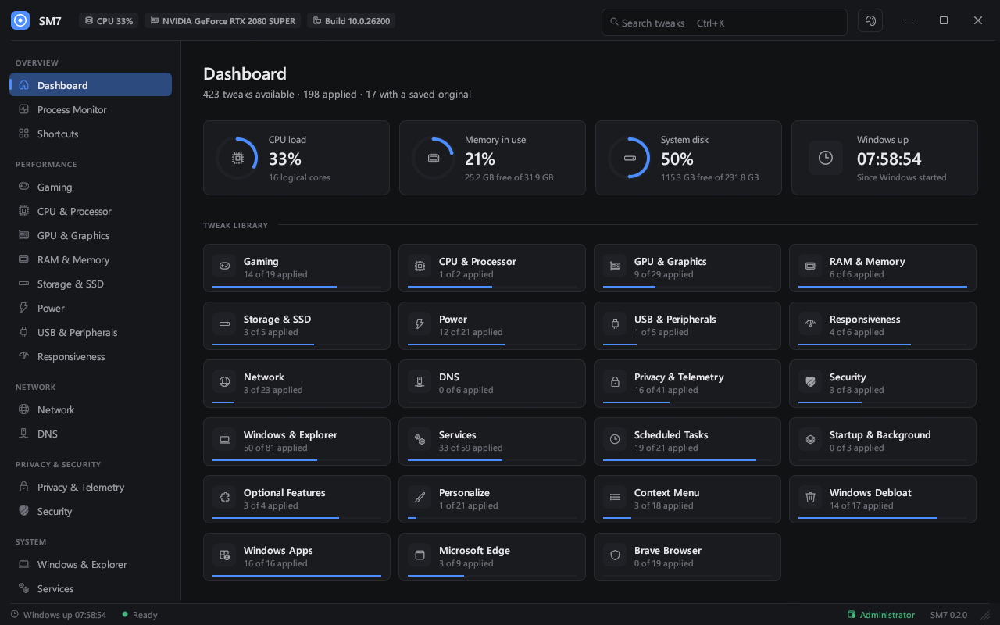
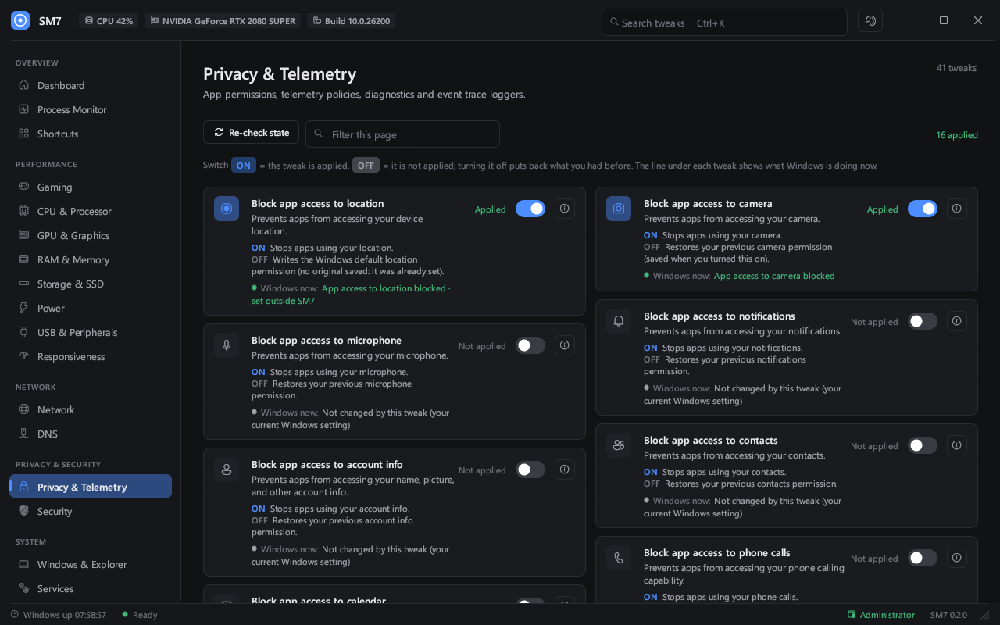
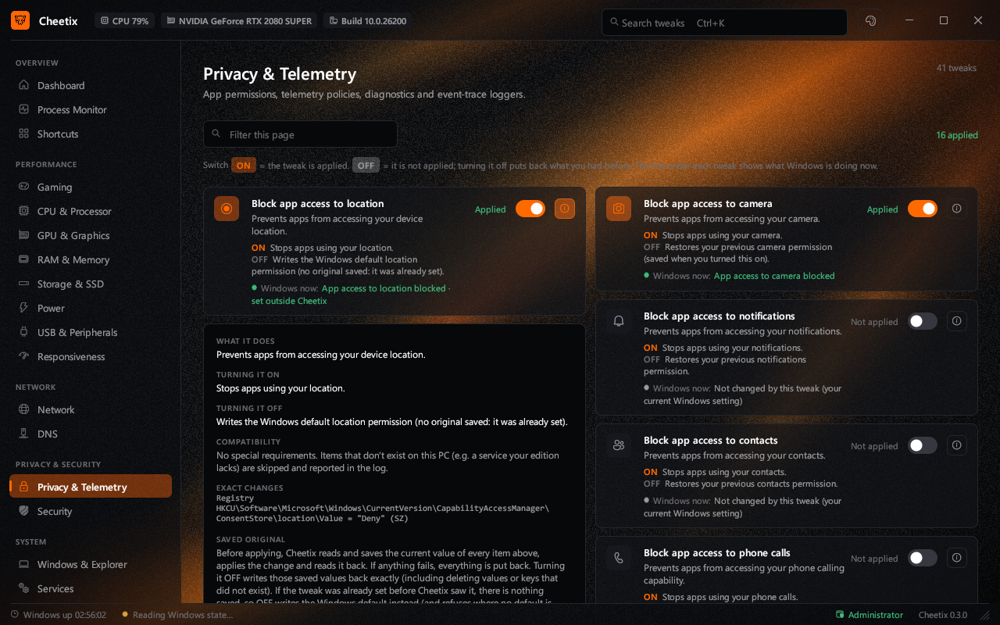
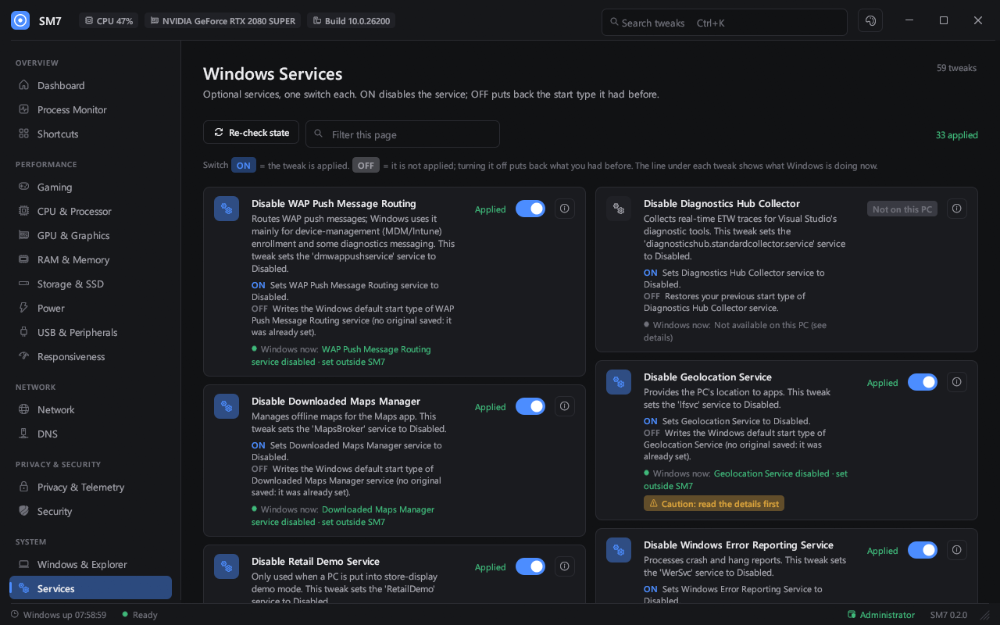
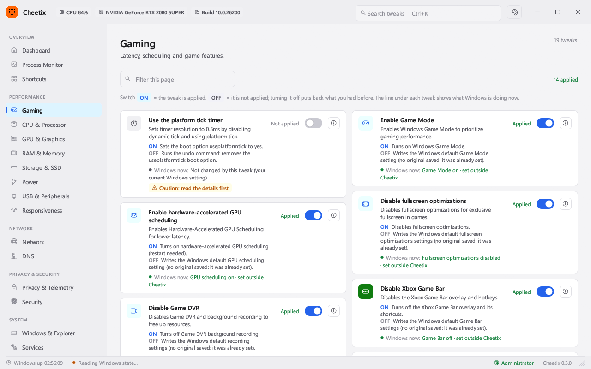
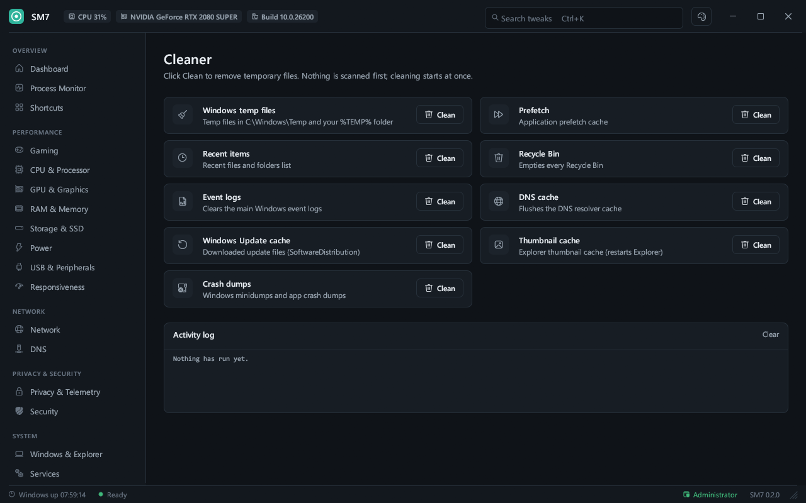

<p align="center">
  
</p>

<h1 align="center">Cheetix</h1>

<p align="center">
  A clean, honest Windows tweaking and debloat tool.<br>
             423 individual Tweaks.
</p>

<p align="center">
  <a href="https://github.com/iiEKiLLeR/Cheetix/releases/latest"><b>Download the installer</b></a> ·
  <a href="#features">Features</a> ·
  <a href="#how-the-switches-work">How the switches work</a> ·
  <a href="#building-from-source">Build from source</a>
</p>



## What Cheetix does

Cheetix brings hundreds of Windows tweaks together in one place: privacy and telemetry, gaming and latency, services, scheduled tasks, network and DNS, power, visual effects, debloating and more. Each tweak is its own switch. Nothing is bundled and nothing is applied automatically: you decide what changes on your PC.

What makes it different is how carefully it changes things:

- **It saves your original settings first.** Before a tweak changes anything, Cheetix reads and stores the exact current value of every setting involved. Turning the tweak OFF writes those values back. It doesn't write a "default" that might not be what you had.
- **It checks its work.** After applying a change it reads the setting back. If any part fails, the whole tweak is rolled back.
- **It shows what Windows is actually doing.** Cheetix reads the real state of every tweak from Windows when it starts, and again each time you open a page. If something outside Cheetix changes a setting later, the card says so.
- **It explains every switch.** Each tweak says what ON does and what OFF restores. An info panel covers why you'd use it, the drawbacks, the risk level, whether a restart is needed, and the exact registry values, services, tasks or power settings it touches.

## Screenshots

| Tweak pages | Details panel |
|---|---|
|  |  |
| **Services, one switch each** | **Light theme** |
|  |  |



## Features

**Tweaks (423), grouped into pages**

| Area | Pages |
|---|---|
| Performance | Gaming · CPU & Processor · GPU & Graphics · RAM & Memory · Storage & SSD · Power · USB & Peripherals · Responsiveness |
| Network | Network (TCP stack, adapters) · DNS & Name Resolution |
| Privacy & Security | Privacy & Telemetry (app permissions, telemetry policies, trace loggers) · Security hardening |
| System | Windows & Explorer · Services (59) · Scheduled Tasks (21) · Startup & Background · Optional Features · Personalize · Context Menu |
| Debloat | Windows Debloat · Windows Apps · Microsoft Edge · Brave Browser |

**Tools**

- **Dashboard**: CPU, memory and disk use, uptime, and how many tweaks are applied on each page.
- **Process Monitor**: the heaviest processes, with protected system processes that can't be ended.
- **Startup Manager**: turn startup programs on or off, the same way Task Manager does. Nothing is deleted.
- **Cleaner**: temp files, prefetch, recent items, Recycle Bin, event logs, DNS cache, Windows Update cache, thumbnail cache and crash dumps.
- **Power Plans**: see and switch power plans.
- **Shortcuts**: one click to 85 Windows settings pages and tools.
- **History**: every change you make, with one-click revert or *Revert all*.
- **Search** (Ctrl+K) across every tweak.
- **Five themes**: Cheetah (black and orange), Mono (black and white) and Violet (black and purple) have a slow, animated aurora background; Slate and Light are flat.


## Install

1. Download `Cheetix-Setup-<version>.exe` from the [latest release](https://github.com/iiEKiLLeR/Cheetix/releases/latest).
2. Run it. Because the installer isn't code-signed yet, Windows SmartScreen may show *"Windows protected your PC"*. Click **More info**, then **Run anyway**.
3. Open Cheetix from the Start menu.

Cheetix checks GitHub for a newer version when it starts. If there is one, a small popup offers **Install now** (downloads the installer, checks it, installs it and restarts Cheetix) or **Later**. You can also run a newer installer over the old one yourself. Either way your settings and saved originals are kept. To uninstall, go to *Settings → Apps → Installed apps → Cheetix*.

Requires Windows 10 or 11 (64-bit).

## Building from source

Cheetix is written in Rust with [egui](https://github.com/emilk/egui). The settings engine is a PowerShell script embedded in the app.

Requirements:

- [Rust](https://rustup.rs) with the GNU toolchain (`x86_64-pc-windows-gnu`)
- MinGW-w64, for example [WinLibs](https://winlibs.com) (`winget install BrechtSanders.WinLibs.POSIX.UCRT`), on `PATH` (provides `windres`, used to embed the icon)
- [Inno Setup 6](https://jrsoftware.org/isinfo.php), only needed to build the installer (`winget install JRSoftware.InnoSetup`)

```powershell
cargo build --release              # target\release\cheetix.exe
cargo test                         # data and logic tests
.\tools\build_installer.ps1        # installer\Output\Cheetix-Setup-<version>.exe
```

`cargo test -- --ignored` runs extra tests against the real system. They read every tweak's state without changing anything, and run restore tests on throw-away registry keys, services, tasks and power plans that they create and delete themselves. Run them as administrator.

### Project layout

| Path | What it is |
|---|---|
| `src/main.rs` | The app: pages, cards, state handling |
| `src/engine.rs` | The save → apply → verify → restore engine |
| `src/sys.rs` | Windows helpers: scripts, metrics, processes, startup items, power plans |
| `src/theme.rs` | Themes and colours |
| `src/icons.rs` | Icons for pages and tweaks |
| `data/tweaks.json`, `data/ops.json` | The tweak definitions |
| `data/labels.json` | The name and ON/OFF text of every tweak |
| `tools/gen_ops.py` | Generates `data/ops.json`; fails on duplicate or overlapping tweaks |
| `tools/convert_legacy.py` | Moves script tweaks onto the restore engine where possible |
| `tools/gen_labels.py` | Generates `data/labels.json` |
| `installer/cheetix.iss` | The installer script |


## License

[MIT](LICENSE)
